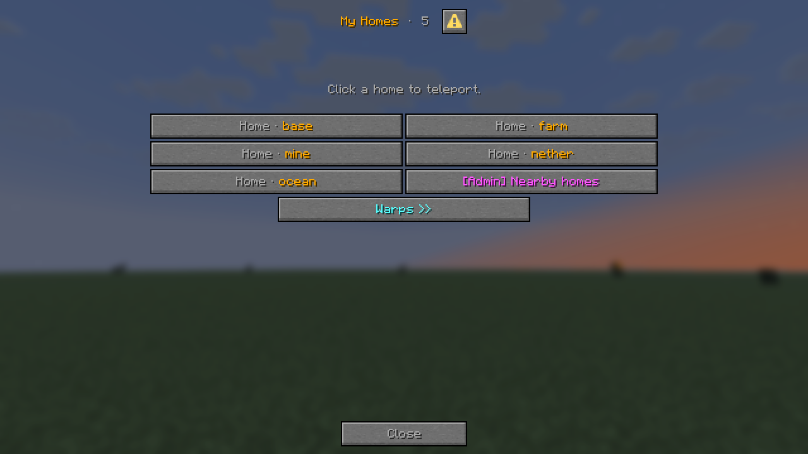
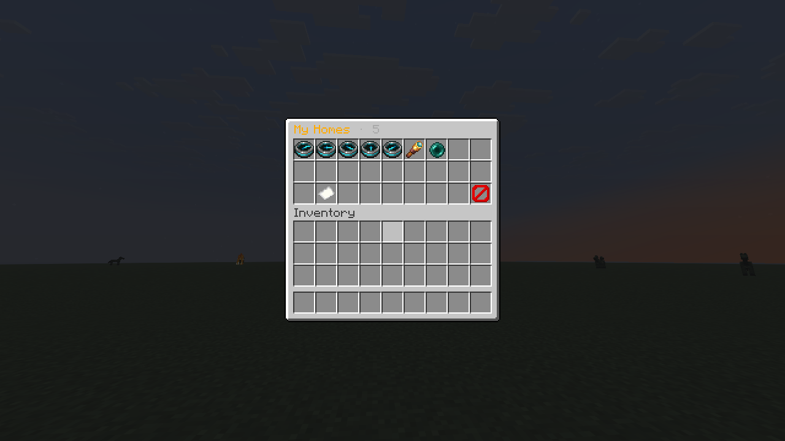

# Essential Commands UI


[简体中文](README.md) | [English](README.en.md)

[](https://github.com/Senmo-awa/ECUI/releases)
[](LICENSE)


A **server-side UI** for [Essential Commands](https://github.com/John-Paul-R/Essential-Commands):
`/home` and `/warp` open a clickable interface. No client mod required.

- Vanilla dialogs or a chest-style inventory UI, with automatic fallback
- Chinese and English (`zh_cn` / `en_us`), optionally following each player's client
- EC commands, permissions, cooldowns and teleport delays stay untouched





## Commands

| Command | Description |
|---|---|
| `/home` | Opens the "My Homes" UI; click to teleport. |
| `/home <name>` | Unchanged EC behavior. |
| `/warp` | Opens the "Warps" UI, showing only permitted warps. |
| `/warp <name>` | Unchanged EC behavior. |
| `/homesnear [radius]` / `/nearbyhomes [radius]` | **Admins only**: scans nearby homes, including offline players, sorted by distance. |
| `/ecui reload` | Reloads `config/ec_ui.json`. |
| `/ecui selftest` | Self-test for the dialog network layer. |

## Compatibility

| Build | Minecraft | Essential Commands | Java |
|---|---|---|---|
| `ec_ui-1.0.0+mc26.3.jar` | 26.3 | 0.42.x | 25 |
| `ec_ui-1.0.0+mc26.2.jar` | 26.2 | 0.41.x / 0.42.0-mc26.2 | 25 |
| `ec_ui-1.0.0+mc26.1.1.jar` | 26.1.1 | 0.39.x | 25 |

Prebuilt jars are in [`release/1.0.0/`](release/1.0.0/); checksums are in [`SHA256SUMS`](release/1.0.0/SHA256SUMS).

1.21.x builds are not provided: EC 0.38 and earlier use different command/permission implementations than 26.x and need a separate adaptation.

## Installation

1. Install **Fabric**, the matching **Fabric API** and **Essential Commands** on the server.
2. Put `ec_ui-1.0.0+mcXX.jar` into `mods/`.
3. Restart the server and run `/home` or `/warp` in game.

Clients do not need ECUI.

## Configuration

`config/ec_ui.json` is generated on first start:

```json
{
  "language": "auto",
  "uiMode": "auto",
  "fallbackToInventory": true,
  "checkHomePermission": true,
  "checkWarpPermission": true,
  "inventoryRows": 6,
  "maxHomeButtons": 60,
  "maxWarpButtons": 60,
  "nearbyDefaultRadius": 128,
  "nearbyMaxRadius": 20000,
  "nearbyMaxResults": 45,
  "includeOfflineHomes": true
}
```

| Field | Description |
|---|---|
| `language` | `auto` / `zh_cn` / `en_us`; `auto` follows the player's client language. |
| `uiMode` | `auto` / `dialog` / `inventory`. |
| `fallbackToInventory` | Fall back to the inventory UI when dialogs are unavailable. |
| `checkHomePermission` / `checkWarpPermission` | Check EC teleport permissions before opening the UI. |
| `inventoryRows` | Chest rows for the inventory UI: `3` or `6`. |
| `maxHomeButtons` / `maxWarpButtons` | Maximum entries in dialog mode. |
| `nearbyDefaultRadius` / `nearbyMaxRadius` / `nearbyMaxResults` | Default radius, maximum radius and result limit for nearby scans. |
| `includeOfflineHomes` | Scan offline players' homes. |

Run `/ecui reload` after editing; no restart needed.

## Permissions

- `/home` and `/warp` stay on EC's command nodes, so **EC's permission checks are unchanged**.
- `/homesnear`, `/nearbyhomes` and `/ecui *` require an admin: OP level ≥ 2, or `essentialcommands.home_tp_others` in LuckPerms.

## `/warp` on 26.3

EC 0.42 builds an `Identifier` from a warp's permission name on 26.3, which throws `IdentifierException` when that name contains uppercase letters (upstream issue: [PR #408](https://github.com/John-Paul-R/Essential-Commands/pull/408)).
ECUI's `/warp` UI and tab completion work around it; EC's own `/warp <name>` still needs the upstream fix.

## Building

Requires JDK 25 and the bundled Gradle wrapper. Put the matching EC jar under `libs/` first:

```bash
# 26.3 (default)
./gradlew clean build

# 26.2
./gradlew clean build -Pminecraft_version=26.2 -Ploader_version=0.18.3 \
  -Pfabric_api_version=0.152.1+26.2 \
  -Pec_jar=libs/versions/essential_commands-0.41.0-mc26.2.jar

# 26.1.1
./gradlew clean build -Pminecraft_version=26.1.1 -Ploader_version=0.18.6 \
  -Pfabric_api_version=0.145.4+26.1.1 \
  -Pec_jar=libs/versions/essential_commands-0.39.0-mc26.1.1.jar
```

The output is `build/libs/ec_ui-1.0.0+mc<version>.jar`.

## License

[MIT](LICENSE)

Essential Commands UI is not an official Essential Commands project. Essential Commands is copyright its respective authors.
